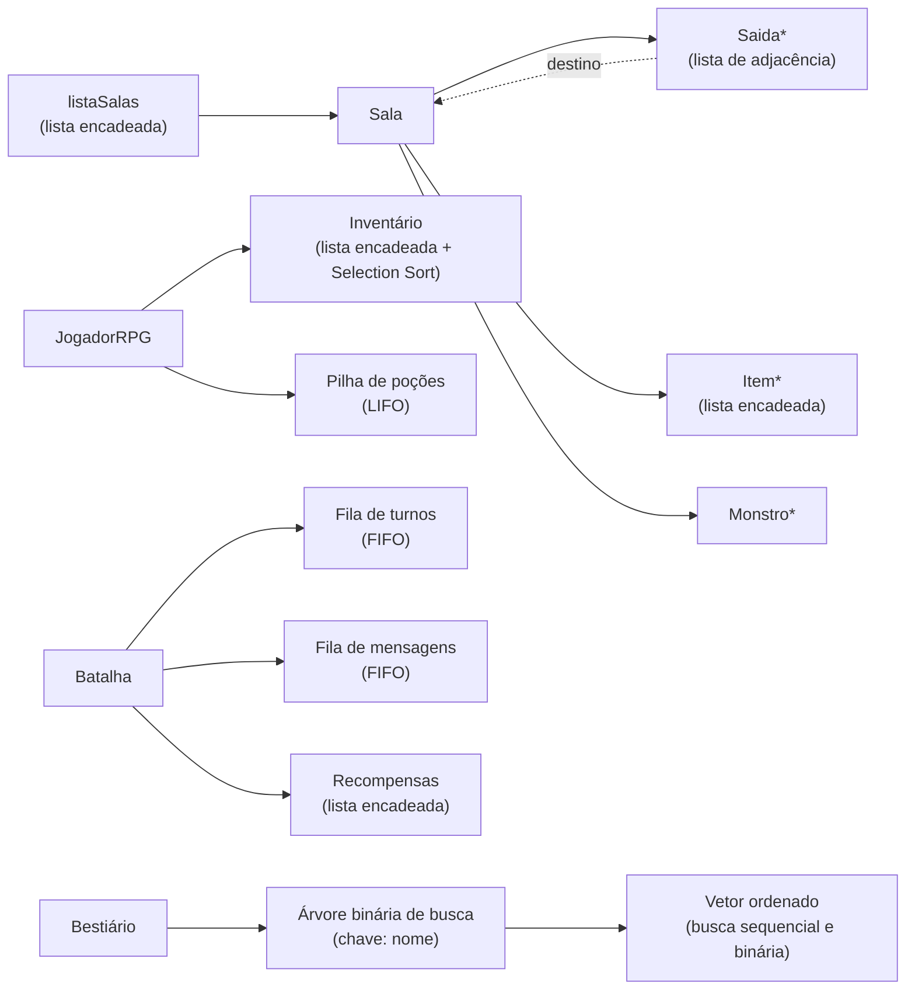

# RPG — Sistema de RPG em C++ com SFML

Jogo de RPG de exploração de masmorra feito em **C++ (SFML 3)** como trabalho de Estruturas de Dados. O jogador explora salas ligadas entre si, coleta itens, enfrenta monstros em **batalhas por turnos**, junta **3 chaves** e derrota o **Boss** para vencer.

> **Tema:** RPG de masmorra.

---

## Descrição do sistema

- **Mapa:** 6 salas (Entrada, sala1, sala2, sala3, intermedio e sala do Boss) ligadas por um grafo. A troca de sala é feita pelo console.
- **Exploração:** o jogador anda pela sala, coleta ou recusa itens e encontra o monstro da sala.
- **Batalha:** encostar no monstro abre uma tela de batalha por turnos (atacar, usar poção, defender ou fugir).
- **Recompensas:** vencer o monstro de uma sala entrega uma **chave** e faz cair um **item** (espada, armadura ou poção).
- **Boss:** a porta da sala do Boss só abre com 3 chaves. Itens recusados durante o jogo aumentam o dano do Boss.
- **Bestiário:** catálogo de monstros consultável pela tecla **B**.

## Controles

| Tecla | Ação |
|---|---|
| `WASD` ou setas | Mover |
| `F` | Trocar de sala (escolha pelo console) |
| `E` / `Q` | Coletar / recusar o item próximo |
| `I` | Abrir ou fechar o inventário (console) |
| `H` | Usar poção |
| `1` `2` `3` `4` | Na batalha: atacar, poção, defender, fugir |
| `B` | Abrir o bestiário (console) |

## Como compilar e executar

Requisitos: compilador com **C++17** e **SFML 3**.

No **MSYS2 UCRT64**:

```bash
pacman -S mingw-w64-ucrt-x86_64-gcc mingw-w64-ucrt-x86_64-sfml
g++ -std=c++17 main.cpp -o jogo.exe -lsfml-graphics -lsfml-window -lsfml-system
./jogo.exe
```

Execute sempre a partir da pasta do projeto: o jogo carrega `img/native/...` por caminho relativo. Para ver os textos da batalha, coloque um `arial.ttf` na pasta (ou em `fonts/`).

## Estrutura do repositório

| Arquivo | Conteúdo |
|---|---|
| `main.cpp` | Mapa, jogador, inventário, itens, monstros e loop principal |
| `batalha.hpp` | Tela de batalha e filas (turnos e mensagens) |
| `recompensas.hpp` | Chave e item entregues ao vencer um monstro |
| `bestiario.hpp` | Bestiário: árvore binária de busca e buscas |
| `img/` | Pixel arts (chão, paredes, monstros) |
| `relatorio_tecnico.txt` | Relatório técnico com as decisões de projeto |

## Diagrama das estruturas de dados



### O mapa (grafo com lista de adjacência)

```
            Entrada
         /     |     \
     sala1   sala2   sala3
         \     |     /
          intermedio
              |
            Boss  (exige 3 chaves)
```

Cada `Sala` é um vértice. Cada `Saida` é um nó de lista encadeada que aponta para a sala de destino. A função `conectar` cria as duas saídas (ida e volta). `listaSalas` registra todas as salas para que `liberarMapa` apague cada uma uma única vez, mesmo com o grafo tendo ciclos.

## Estruturas e algoritmos por requisito

| Req. | Conteúdo | Onde está |
|---|---|---|
| R1 Funções | Funções de responsabilidade única; passagem por valor, referência, `const&` e parâmetro default | `main.cpp`, `batalha.hpp` |
| R2 Ponteiros | `Sala*`, `Saida*`, `Item*`, `Sala*&` em `moverJogador` | `main.cpp` |
| R3 Recursividade | `buscarItemRecursivoRPG`, `mostrarItensRecursivoRPG`, funções da ABB | `main.cpp`, `bestiario.hpp` |
| R4 Memória dinâmica | `new`/`delete` em todos os nós das estruturas | todos |
| R5 Lista encadeada | Salas, saídas, itens, inventário, recompensas | `main.cpp`, `recompensas.hpp` |
| R6 Pilha | Poções: a última coletada é a primeira usada | `empilharPocaoRPG`, `usarPocaoRPG` |
| R7 Fila | Turnos da batalha e log de mensagens | `batalha.hpp` |
| R8 ABB | Bestiário indexado pelo nome, com travessia in-ordem | `bestiario.hpp` |
| R9 Ordenação | Selection Sort no inventário, com análise de complexidade comentada | `ordenarInventarioRPG` |
| R10 Busca | Busca sequencial e binária, com comparações e tempo medidos | `bestiario.hpp` |

## Divisão de responsabilidades

| Integrante | Responsabilidades |
|------------|-------------------|
| **Isabely** | Sistema de batalha e recompensas, mapa, readme |
| **Emily** | Movimentação e colisões, detecção de objetos, inventário e itens |
| **Marya** | Monstros e pixel arts, e ajustes finais |
